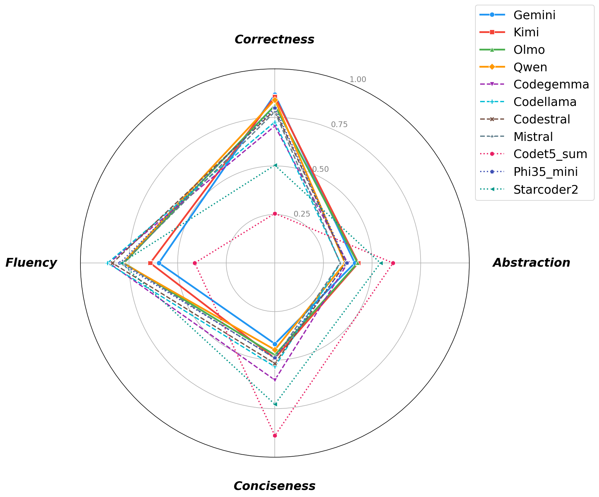
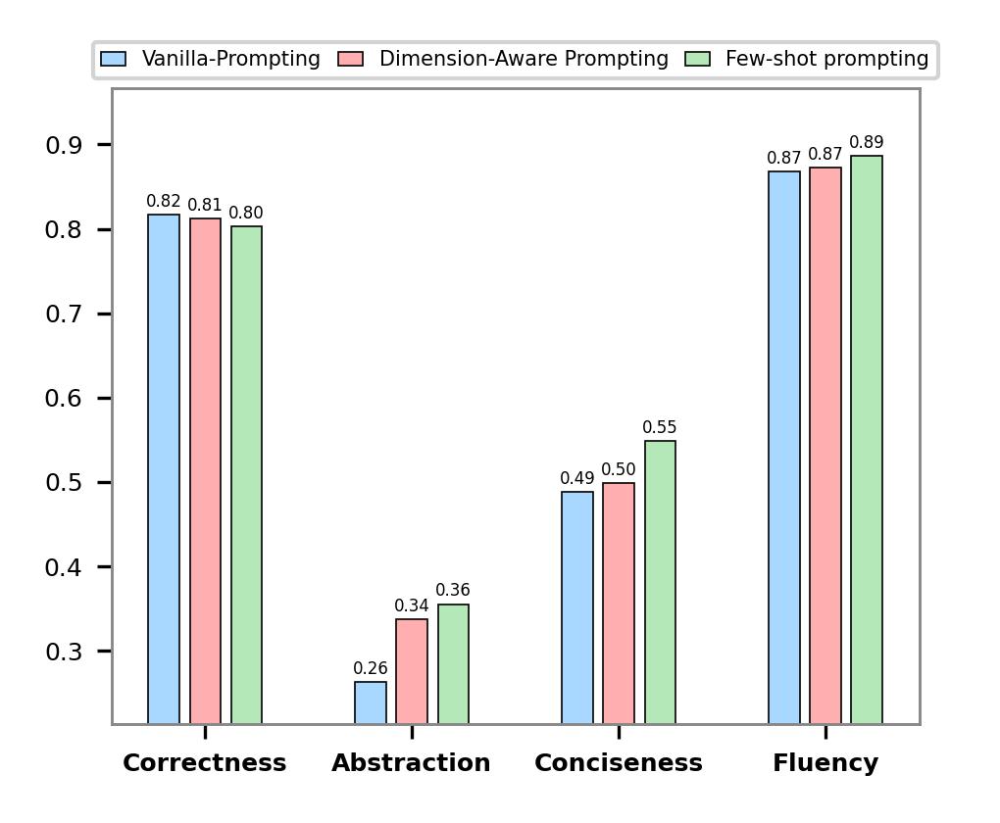
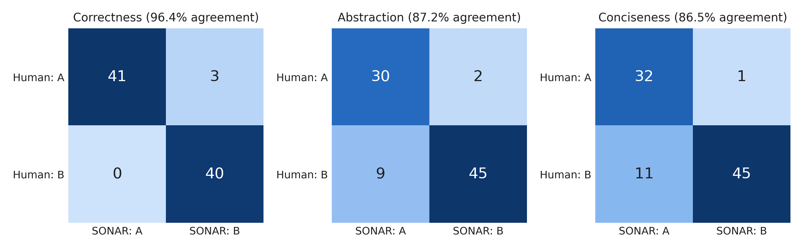

# SONAR
This repository contains the **replication package** introduced in the paper:

> ## SONAR: Reference-Free, Task-Aware Evaluation of Code Summaries from the Perspective of LLMs

<br>

**Note:** Tables and figures in the reproduction sections use the paper's numbering; tables in the [Appendix](#books-appendix) use their own numbering.

---
## :gear: Conda Environment
1. Create a Conda env
```bash
conda create -n sonar python=3.10
```
2. Activate the environment
```bash
conda activate sonar
```
3. Install dependencies
```bash
pip install -r requirements.txt
```

## :file_folder: Repository Structure
| Folder | Contents |
|---|---|
| [`SONAR_Framework`](SONAR_Framework) | The SONAR tool: summary generation and the four scorers |
| [`Experiments/RQ1`](Experiments/RQ1) | Human-labelled pairs, SONAR and LLM-judge scores, Table I |
| [`Experiments/RQ2`](Experiments/RQ2) | Downstream task data and pipelines (retrieval, translation, optimization, test oracle generation) |
| [`Experiments/RQ3`](Experiments/RQ3) | Per-LLM and per-prompting-strategy SONAR scores, Figures 5 and 6 |
| [`Experiments/Major_Revision`](Experiments/Major_Revision) | Data, code and results of the experiments added in the major revision |

| `Experiments/Major_Revision/` | Contents |
|---|---|
| [`Association`](Experiments/Major_Revision/Association) | Confounder-controlled partial Spearman correlations (Table III of the paper) |
| [`LLM_Judges`](Experiments/Major_Revision/LLM_Judges) | LLM-as-a-judge baselines (Crupi et al., CodeRPE, Claude Opus 4.8): prompts, script and scores |
| [`Sensitivity`](Experiments/Major_Revision/Sensitivity) | Sensitivity analysis (Table IV of the paper, Appendix Table I) |
| [`Prompting_Downstream`](Experiments/Major_Revision/Prompting_Downstream) | Downstream effect of prompting for Abstraction (Appendix Table II) |
| [`Generator_Errors`](Experiments/Major_Revision/Generator_Errors) | Code-generation error analysis (Appendix Table III) |
| [`Human_Labels`](Experiments/Major_Revision/Human_Labels) | Label prevalence and confusion matrices for RQ1 (Appendix Table IV) |
| [`Cost`](Experiments/Major_Revision/Cost) | Cost per summary (Appendix, Cost per summary) |

## :bar_chart: Reproducing RQ1 results
```bash
cd Experiments/RQ1/scripts
chmod +x run.sh
./run.sh
```
This generates Table I in [`Experiments/RQ1/results/agreement_table.csv`](Experiments/RQ1/results/agreement_table.csv).

**Table I: Agreement rate (%) of SONAR and LLM-only scorers with human preferences**

| Scorer | Correctness | Abstraction | Conciseness | Overall |
|---|---|---|---|---|
| SONAR | 96 | 87 | 87 | 90 |
| Gemini 3.1 Pro | 51 | 76 | 62 | 63 |
| Claude Opus 4.8 | 60 | 77 | 79 | 72 |

## :bar_chart: Reproducing RQ2 results
```bash
cd Experiments/RQ2/scripts
chmod +x run.sh
./run.sh
```
This generates Table III (partial Spearman correlation between each method and downstream performance, with 95% bootstrap CIs).

**Table III: Partial Spearman correlation (r<sub>ρ</sub>) between each method and downstream performance.** Brackets: 95% CI. \* p < 0.05, \*\* p < 0.01, \*\*\* p < 0.001.

| Method | Dimension | MRR | CA@1 | Edit Dist. | Pass@1 | Speedup | Success Rate |
|---|---|---|---|---|---|---|---|
| SONAR | Correctness | 0.06\*\* [0.02, 0.10] | 0.37\*\*\* [0.28, 0.45] | −0.12\*\*\* [−0.17, −0.07] | 0.51\*\*\* [0.40, 0.61] | −0.01 [−0.08, 0.07] | 0.24\*\*\* [0.19, 0.30] |
|  | Abstraction | 0.13\*\*\* [0.08, 0.18] | −0.02 [−0.06, 0.04] | 0.13\*\*\* [0.08, 0.18] | 0.03 [−0.03, 0.09] | 0.15\*\*\* [0.07, 0.22] | −0.02 [−0.06, 0.02] |
|  | Conciseness | 0.01 [−0.03, 0.04] | 0.01 [−0.03, 0.05] | 0.04\* [0.00, 0.07] | −0.06\* [−0.10, −0.00] | −0.05 [−0.11, 0.02] | 0.00 [−0.04, 0.04] |
|  | Fluency | −0.00 [−0.05, 0.05] | −0.05\* [−0.10, −0.00] | −0.02 [−0.06, 0.02] | −0.05 [−0.10, 0.01] | 0.01 [−0.04, 0.06] | −0.05\* [−0.10, −0.01] |
| Crupi | Content Adequacy | 0.04 [−0.01, 0.08] | 0.12\*\* [0.04, 0.20] | −0.03 [−0.08, 0.02] | 0.18\*\* [0.06, 0.30] | 0.01 [−0.07, 0.08] | 0.09\*\*\* [0.05, 0.13] |
|  | Conciseness | 0.02 [−0.01, 0.05] | 0.00 [−0.05, 0.06] | −0.03 [−0.07, 0.01] | 0.07\* [0.01, 0.13] | 0.02 [−0.06, 0.09] | 0.01 [−0.02, 0.04] |
|  | Fluency | −0.02 [−0.06, 0.03] | 0.11\*\*\* [0.05, 0.17] | −0.05\* [−0.09, −0.01] | 0.08\* [0.00, 0.17] | −0.00 [−0.07, 0.07] | 0.12\*\*\* [0.08, 0.16] |
| CodeRPE | Coherence | 0.00 [−0.03, 0.04] | 0.04 [−0.00, 0.09] | −0.06\*\* [−0.10, −0.02] | 0.02 [−0.03, 0.09] | −0.02 [−0.07, 0.03] | 0.07\*\*\* [0.04, 0.10] |
|  | Consistency | 0.02 [−0.02, 0.06] | 0.19\*\*\* [0.13, 0.26] | −0.07\*\* [−0.10, −0.03] | 0.26\*\*\* [0.16, 0.34] | 0.04 [−0.01, 0.08] | 0.16\*\*\* [0.12, 0.20] |
|  | Fluency | −0.03 [−0.06, 0.00] | 0.02 [−0.04, 0.08] | −0.02 [−0.06, 0.02] | 0.05 [−0.04, 0.14] | −0.00 [−0.06, 0.05] | 0.04\* [0.00, 0.09] |
|  | Relevance | −0.00 [−0.04, 0.04] | 0.01 [−0.04, 0.05] | −0.02 [−0.06, 0.02] | 0.01 [−0.05, 0.07] | 0.04 [−0.02, 0.09] | 0.02 [−0.02, 0.06] |
| Claude Opus 4.8 | Correctness | −0.01 [−0.06, 0.03] | 0.26\*\*\* [0.18, 0.34] | −0.10\*\* [−0.15, −0.04] | 0.36\*\*\* [0.25, 0.46] | 0.04 [−0.03, 0.12] | 0.19\*\*\* [0.15, 0.24] |
|  | Abstraction | −0.01 [−0.06, 0.04] | −0.01 [−0.06, 0.04] | 0.05\* [0.01, 0.09] | −0.02 [−0.08, 0.04] | 0.16\*\*\* [0.06, 0.26] | 0.03 [−0.01, 0.07] |
|  | Conciseness | 0.05 [−0.01, 0.09] | 0.05 [−0.00, 0.10] | −0.04 [−0.07, −0.00] | 0.04 [−0.02, 0.12] | −0.07 [−0.14, 0.02] | 0.06\*\*\* [0.03, 0.09] |
| Reference-based | BLEU-4 | −0.08\* [−0.17, −0.00] | 0.02 [−0.03, 0.07] | −0.00 [−0.06, 0.05] | 0.05 [−0.02, 0.12] | 0.04 [−0.03, 0.10] | 0.06\*\* [0.02, 0.10] |
|  | ROUGE-L | −0.05 [−0.11, 0.01] | 0.02 [−0.03, 0.06] | −0.01 [−0.07, 0.05] | 0.05 [−0.02, 0.11] | 0.07 [−0.01, 0.15] | 0.06\*\* [0.02, 0.10] |
|  | METEOR | −0.02 [−0.07, 0.04] | 0.06\*\* [0.02, 0.09] | 0.00 [−0.05, 0.06] | 0.07\* [0.01, 0.12] | 0.07\* [0.01, 0.13] | 0.07\*\* [0.03, 0.11] |
|  | BLEURT | 0.01 [−0.04, 0.07] | 0.05 [−0.00, 0.10] | −0.07\*\* [−0.11, −0.03] | 0.11\*\* [0.05, 0.17] | 0.05 [−0.01, 0.12] | 0.09\*\*\* [0.05, 0.13] |
|  | BERTScore F1 | −0.02 [−0.08, 0.04] | 0.06\*\* [0.02, 0.11] | −0.02 [−0.08, 0.03] | 0.10\*\* [0.05, 0.17] | 0.02 [−0.07, 0.12] | 0.09\*\* [0.04, 0.13] |

## :bar_chart: Reproducing RQ3 results
```bash
cd Experiments/RQ3/scripts
chmod +x run.sh
./run.sh
```
This generates Figure 5 and Figure 6 in [`Experiments/RQ3/results`](Experiments/RQ3/results).




The downstream effect of prompting (§VI-E) is reproduced with:
```bash
cd Experiments/Major_Revision/Prompting_Downstream/scripts
python3 create_table.py
```

## :bar_chart: Reproducing RQ4 results
```bash
cd Experiments/Major_Revision/Sensitivity/scripts
python3 create_table.py
```
This generates Table IV (MAD and Spearman ρ under each configuration) in [`Experiments/Major_Revision/Sensitivity/results/sensitivity_table.csv`](Experiments/Major_Revision/Sensitivity/results/sensitivity_table.csv), together with the confidence intervals of [Appendix Table I](#table-i-sensitivity-of-sonar-to-llm-configuration-rq4).

**Table IV: Sensitivity of SONAR scores to alternative configurations.**

| Configuration | Correctness MAD | Correctness r<sub>ρ</sub> | Conciseness MAD | Conciseness r<sub>ρ</sub> | Abstraction MAD | Abstraction r<sub>ρ</sub> |
|---|---|---|---|---|---|---|
| Run 1 | 0.049 | 0.912 | 0.054 | 0.868 | 0.058 | 0.862 |
| Run 2 | 0.054 | 0.899 | 0.061 | 0.859 | 0.062 | 0.877 |
| Temp. = 0 | 0.035 | 0.966 | 0.051 | 0.877 | – | – |
| Temp. = 0.5 | 0.035 | 0.903 | 0.047 | 0.869 | – | – |
| Temp. = (0.2, 0.5, 0.8) | – | – | – | – | 0.068 | 0.833 |
| Temp. = (0.8, 1.0, 1.2) | – | – | – | – | 0.067 | 0.843 |
| Top-p = 0.5 | 0.040 | 0.927 | 0.040 | 0.875 | 0.066 | 0.833 |
| Top-p = 0.8 | 0.047 | 0.892 | 0.067 | 0.859 | 0.062 | 0.862 |
| G: Qwen | 0.042 | 0.891 | 0.037 | 0.939 | – | – |
| G: OLMo | 0.055 | 0.878 | 0.036 | 0.943 | – | – |
| P: Qwen | – | – | 0.052 | 0.924 | – | – |
| P: OLMo | – | – | 0.047 | 0.931 | – | – |
| 𝒢: Kimi, Codestral, GLM | – | – | – | – | 0.072 | 0.856 |
| V = 2 (6 implementations) | – | – | – | – | 0.024 | 0.978 |
| V = 1 (3 implementations) | – | – | – | – | 0.067 | 0.946 |
| Empty summary | 0.446 | 0.234 | 0.295 | 0.307 | 0.271 | 0.258 |

## :scroll: Reproducing the Appendix tables
**Table I: Sensitivity of SONAR to LLM configuration (RQ4)** → [`Experiments/Major_Revision/Sensitivity/results`](Experiments/Major_Revision/Sensitivity/results) (`sensitivity_table.csv`)
```bash
cd Experiments/Major_Revision/Sensitivity/scripts
python3 create_table.py
```
**Table II: Downstream effect of prompting for Abstraction (RQ3)** → [`Experiments/Major_Revision/Prompting_Downstream/results`](Experiments/Major_Revision/Prompting_Downstream/results) (`few_shot_downstream.csv` and `dim_aware_downstream.csv`)
```bash
cd Experiments/Major_Revision/Prompting_Downstream/scripts
python3 create_table.py
```
**Table III: Code-generation errors** → [`Experiments/Major_Revision/Generator_Errors/results`](Experiments/Major_Revision/Generator_Errors/results) (`generator_errors.csv`)
```bash
cd Experiments/Major_Revision/Generator_Errors/scripts
python3 create_table.py
```
**Table IV: Human labels and SONAR agreement per dimension (RQ1)** → [`Experiments/Major_Revision/Human_Labels/results`](Experiments/Major_Revision/Human_Labels/results) (`label_table.csv` and `confusion_matrices.png`)
```bash
cd Experiments/Major_Revision/Human_Labels/scripts
python3 create_table.py
```
**Cost per summary** → [`Experiments/Major_Revision/Cost/results`](Experiments/Major_Revision/Cost/results) (`cost_per_summary.csv`, `cost_table.csv` and `execution_failures.csv`)
```bash
cd Experiments/Major_Revision/Cost/scripts
python3 create_table.py
```

---
## :robot: Running the SONAR Framework
[`SONAR_Framework`](SONAR_Framework) is the standalone tool underlying all four RQs above: for each task in the bundled benchmark (`SONAR_Framework/datasets`, 500 functions across HumanEval, MBPP, BigCodeBench, and TheVault), it generates summaries with any of 11 models and scores those summaries on all four SONAR dimensions (correctness, abstraction, conciseness, fluency).
```bash
cd SONAR_Framework
chmod +x run.sh
./run.sh
```
See [`SONAR_Framework/run.sh`](SONAR_Framework/run.sh) for detailed setup instructions.

---
## :books: Appendix
- [Table I: Sensitivity of SONAR to LLM configuration (RQ4)](#table-i-sensitivity-of-sonar-to-llm-configuration-rq4)
- [Table II: Downstream effect of prompting for Abstraction (RQ3)](#table-ii-downstream-effect-of-prompting-for-abstraction-rq3)
- [Table III: Code-generation errors](#table-iii-code-generation-errors)
- [Table IV: Human labels and SONAR agreement per dimension (RQ1)](#table-iv-human-labels-and-sonar-agreement-per-dimension-rq1)
- [Configurations, Settings and Cost](#configurations-settings-and-cost)
  - [Scoring dimensions](#scoring-dimensions)
  - [Differential fuzzing](#differential-fuzzing-correctness-and-conciseness)
  - [Summary generation](#summary-generation)
  - [Timeouts and retries](#timeouts-and-retries)
  - [Cost per summary](#cost-per-summary)

### Table I: Sensitivity of SONAR to LLM configuration (RQ4)
**Experimental setup**
- 100 summaries sampled with a fixed seed; G/P rows use about 1,000 summaries.
- Temperature sets: each Abstraction pool model draws its 3 samples at the listed temperatures.
- Pool sizes 6 and 3 are subsets of the same run's pool of 9.

Cells: MAD / Spearman ρ [95% CI] / human agreement (Δ pp relative to the original configuration's agreement in RQ1, last row).

| Factor | Setting | Correctness | Conciseness | Abstraction |
|---|---|---|---|---|
| Repeated Runs | Run 1 | 0.049 / 0.912 [0.813, 0.983] / 94.0% (-2.4) | 0.054 / 0.868 [0.776, 0.929] / 84.3% (-2.2) | 0.058 / 0.862 [0.767, 0.924] / 83.7% (-3.5) |
|   | Run 2 | 0.054 / 0.899 [0.790, 0.977] / 92.9% (-3.6) | 0.061 / 0.859 [0.765, 0.922] / 83.1% (-3.4) | 0.062 / 0.877 [0.793, 0.927] / 84.9% (-2.3) |
| Decoding Parameters | Temp. = 0 | 0.035 / 0.966 [0.898, 1.000] / 92.9% (-3.6) | 0.051 / 0.877 [0.787, 0.934] / 85.4% (-1.1) | — |
|   | Temp. = 0.5 | 0.035 / 0.903 [0.795, 0.984] / 91.7% (-4.8) | 0.047 / 0.869 [0.781, 0.928] / 83.1% (-3.4) | — |
|   | Temp. = (0.2, 0.5, 0.8) | — | — | 0.068 / 0.833 [0.726, 0.907] / 86.0% (-1.2) |
|   | Temp. = (0.8, 1.0, 1.2) | — | — | 0.067 / 0.843 [0.738, 0.913] / 86.0% (-1.2) |
|   | Top-p = 0.5 | 0.040 / 0.927 [0.834, 0.996] / 95.2% (-1.2) | 0.040 / 0.875 [0.784, 0.932] / 91.0% (+4.5) | 0.066 / 0.833 [0.720, 0.907] / 86.0% (-1.2) |
|   | Top-p = 0.8 | 0.047 / 0.892 [0.786, 0.975] / 91.7% (-4.8) | 0.067 / 0.859 [0.774, 0.916] / 88.6% (+2.1) | 0.062 / 0.862 [0.767, 0.924] / 86.0% (-1.2) |
| Model Selection | G: Qwen | 0.042 / 0.891 [0.860, 0.919] / 90.5% (-6.0) | 0.037 / 0.939 [0.927, 0.950] / 82.6% (-4.0) | — |
|   | G: OLMo | 0.055 / 0.878 [0.846, 0.906] / 83.1% (-13.3) | 0.036 / 0.943 [0.931, 0.953] / 84.3% (-2.2) | — |
|   | P: Qwen | — | 0.052 / 0.924 [0.908, 0.937] / 82.0% (-4.5) | — |
|   | P: OLMo | — | 0.047 / 0.931 [0.917, 0.943] / 88.8% (+2.2) | — |
|   | Gemini → Kimi K2.5 | — | — | 0.069 / 0.880 [0.799, 0.930] / 81.4% (-5.8) |
|   | Qwen → Codestral-22B | — | — | 0.064 / 0.893 [0.820, 0.936] / 82.6% (-4.7) |
|   | OLMo → GLM-4-32B | — | — | 0.067 / 0.868 [0.789, 0.917] / 87.2% (0.0) |
|   | All three replaced (Kimi, Codestral, GLM) | — | — | 0.072 / 0.856 [0.753, 0.919] / 83.7% (-3.5) |
| Pool Size | V = 2 (6 implementations) | — | — | 0.024 / 0.978 [0.950, 0.991] / 84.9% (-2.3) |
|   | V = 1 (3 implementations) | — | — | 0.067 / 0.946 [0.902, 0.968] / 84.9% (-2.3) |
| Context-Only | Empty summary | 0.446 / 0.234 [0.206, 0.262] | 0.295 / 0.307 [0.278, 0.336] | 0.271 / 0.258 [0.233, 0.284] |
| Original | Human agreement (RQ1) | 96.4% | 86.5% | 87.2% |

### Table II: Downstream effect of prompting for Abstraction (RQ3)
**Experimental setup**
- Each prompted summary is paired with the Vanilla summary of the same function and summarizer.
- Each summary's outcome is averaged over the downstream models with results for both summaries of the pair.
- Δ Abstraction: mean of (prompted − Vanilla) Abstraction over all pairs, in percentage points.
- Δ Task outcome: how much higher the outcome is with prompted summaries than with Vanilla summaries, relative to the Vanilla level. For MRR and Edit Dist., the average paired change divided by the average Vanilla outcome (e.g., few-shot MRR: +0.044 over a Vanilla average of 0.439 = +9.9%). For Speedup, the average ratio of prompted to Vanilla speedup, as a geometric mean (e.g., 1.373× = +37.3%).
- p: two-sided Wilcoxon signed-rank test on the paired changes of all pairs. The test uses the ranks of the changes, not their sizes, so it is significant only when most pairs improve; a few very large gains cannot make the result significant on their own. This is why dimension-aware Speedup is not significant (p = 0.769) despite its large average gain (+40.6%): its pairs split almost evenly between improved and worse (117 vs 122).

| Strategy | Task | Pairs (functions) | Δ Abstraction (pp) | Δ Task outcome | Wilcoxon p | Pairs with higher Abstraction: improved / tied / worse |
|---|---|---|---|---|---|---|
| Few-shot | Retrieval (MRR) | 203 (59) | +10.6 | +9.9% | < 0.001 | 142: 100 / 1 / 41 |
| | Translation diversity (Edit Dist.) | 228 (63) | +11.2 | +6.6% | 0.049 | 164: 91 / 1 / 72 |
| | Optimization (Speedup) | 131 (42) | +12.0 | +37.3% | 0.017 | 96: 58 / 0 / 38 |
| Dimension-aware | Retrieval (MRR) | 437 (60) | +10.6 | +3.3% | 0.014 | 332: 195 / 7 / 130 |
| | Translation diversity (Edit Dist.) | 482 (64) | +10.1 | +7.7% | 0.002 | 362: 211 / 3 / 148 |
| | Optimization (Speedup) | 302 (44) | +11.3 | +40.6% | 0.769 | 240: 117 / 1 / 122 |

### Table III: Code-generation errors
**Experimental setup**
- The 3,891 downstream-task summaries are scored for functional similarity with Gemini 2.5 Flash, Qwen 2.5 Coder 32B and OLMo 32B Instruct as the generator.
- Correct: functional similarity ≥ 0.95; wrong: functional similarity < 0.5.

| Analysis | Generator | Measure | Value |
|---|---|---|---|
| Same summary, different generators | Gemini | Wrong code on summaries another generator implemented correctly | 5.1% |
| | Qwen | | 5.1% |
| | OLMo | | 6.4% |
| Same generator, different summaries of the same function | Gemini (SONAR's generator) | Zero-scored summaries whose function has another summary implemented correctly | 84.4% |
| | | Functions with a zero-scored summary that also have a correctly implemented summary | 90.9% |

### Table IV: Human labels and SONAR agreement per dimension (RQ1)

| Dimension | Pairs | Human label A / B | Human A: SONAR A / B / tie | Human B: SONAR B / A / tie | Agreement | Balanced agreement | Majority-label baseline |
|---|---|---|---|---|---|---|---|
| Correctness | 84 | 44 / 40 | 41 / 3 / 0 | 40 / 0 / 0 | 96.4% | 96.6% | 52.4% |
| Abstraction | 86 | 32 / 54 | 30 / 2 / 0 | 45 / 9 / 0 | 87.2% | 88.5% | 62.8% |
| Conciseness | 89 | 33 / 56 | 32 / 1 / 0 | 45 / 11 / 0 | 86.5% | 88.7% | 62.9% |

Majority-label baseline: agreement obtained by always choosing the more frequent human label.



### Configurations, Settings and Cost
These are the defaults in [`SONAR_Framework`](SONAR_Framework), used for every reported score unless an RQ4 setting changes them.

#### Scoring dimensions
| Dimension | Models | Calls per summary | Decoding |
|---|---|---|---|
| Correctness | Generator G: Gemini 2.5 Flash | 1 G call, 1 fuzzing comparison | T = 1.0, top-p = 0.95 |
| Conciseness | Compressor P and generator G: Gemini 2.5 Flash | 3 P calls, 4 G calls, 3 fuzzing comparisons | T = 1.0, top-p = 0.95 |
| Abstraction | Pool: Gemini 2.5 Flash, OLMo 32B Instruct, Qwen 2.5 Coder 32B | 3 samples × 3 models = 9 calls | One sample per model at each of T = 0.5, 0.8, 1.0; top-p = 0.95 |
| Fluency | GPT-2 (124M) | 1 forward pass | — |

Prompts: code generation by G, `CODE_GEN_PROMPT` in [`generate_and_score.py`](SONAR_Framework/generate_and_score.py); code generation by the Abstraction pool, `CODE_GEN_SYSTEM` in [`calculate_abstraction.py`](SONAR_Framework/calculate_abstraction.py); compression (P), `COMPRESS_PROMPT` in [`generate_and_score.py`](SONAR_Framework/generate_and_score.py).

#### Differential fuzzing (Correctness and Conciseness)
| Setting | Value |
|---|---|
| Method | Differential fuzzing of [DIFUZZI](https://arxiv.org/abs/2610.38337) |
| Input generator | Synthesized by an LLM (Gemini 2.5 Flash) for each reference function, and validated before fuzzing |
| Fuzzer | Atheris (coverage-guided) |
| Runs per comparison | 3 |
| Inputs per run | Up to 1,000 compared inputs, at most 5,000 attempts |
| Timeout | 60 s per run; a run that times out contributes no score |
| Output equality | Exact, with relative tolerance 1e-9 for floats; NaN equals NaN |
| Exceptions | Both functions raise: agree. The reference returns and the candidate raises: disagree. The reference raises: input discarded. |
| Seeds | 42 |
| No valid run | If all 3 runs time out, crash or discard every input, the comparison has no score (`None`). |

#### Summary generation
| Model | Access | Decoding |
|---|---|---|
| Gemini 2.5 Flash | Vertex AI or Gemini API | API defaults |
| Kimi K2.5 | OpenAI-compatible API | API defaults |
| OLMo 32B Instruct, Qwen 2.5 Coder 32B, CodeGemma-7B-it, Mistral-7B-Instruct-v0.3, CodeLlama-13B-Instruct, Codestral-22B-v0.1, Phi-3.5-mini-instruct | Local weights, chat template | Greedy, 512 new tokens |
| StarCoder2-3B | Local weights, completion prompt | Greedy, 128 new tokens; first paragraph kept |
| CodeT5-base-sum-python | Local weights, code only | Beam search (4 beams), max length 64, repetition penalty 2.5 |

| Setting | Value |
|---|---|
| Prompting strategies | Vanilla, Dimension-Aware, and Few-shot with two fixed examples (`PROMPTS` in [`generate_and_score.py`](SONAR_Framework/generate_and_score.py)) |
| Precision of local models | bfloat16 on GPUs with compute capability 8.0 or higher, otherwise float16 |

#### Timeouts and retries
| Setting | Value |
|---|---|
| Gemini call | 120 s for generation, 240 s for compression; up to 5 retries with exponential back-off on rate limits |
| Joern | 120 s per batch of 9 functions |

#### Cost per summary
Measured on the 100 sampled summaries of Table I (local models on one NVIDIA A100 80GB; Gemini calls from the logs of the RQ4 runs). Model calls per summary are listed in [Scoring dimensions](#scoring-dimensions); Fluency needs one GPT-2 forward pass.

**Mean per summary** (Gemini 2.5 Flash at $0.30 / $2.50 per million input / generated tokens)

| Dimension | Generated tokens | Time (s) | GPU time (s) | Gemini cost (USD) |
|---|---|---|---|---|
| Correctness | 1,365 | 7.8 | 0.0 | $0.0035 |
| Conciseness | 9,557 | 54.3 | 0.0 | $0.0243 |
| Abstraction | 5,355 | 57.8 | 29.4 | $0.0123 |
| **Total (dimensions in parallel)** | **16,277** | **57.8** | **29.4** | **$0.0401** |

N.B. The number of model calls can be reduced with a smaller Abstraction pool, at some loss of precision (a pool of 6 keeps ρ = 0.978 with the pool of 9; Table IV), and Gemini as G and P can be replaced by open-source models such as Qwen or OLMo (ρ ≥ 0.878; Table IV), removing the API cost of Correctness and Conciseness.

**Breakdown**

| Dimension | Component | Measure | Mean | Median |
|---|---|---|---|---|
| Correctness + Conciseness | Gemini 2.5 Flash | input tokens per call | 175.99 | 156.00 |
| Correctness + Conciseness | Gemini 2.5 Flash | output tokens per call | 149.04 | 109.00 |
| Correctness + Conciseness | Gemini 2.5 Flash | thinking tokens per call | 1216.19 | 581.00 |
| Correctness + Conciseness | Gemini 2.5 Flash | seconds per call | 7.30 | 3.86 |
| Abstraction | Gemini 2.5 Flash | input tokens per call | 231.79 | 201.00 |
| Abstraction | Gemini 2.5 Flash | output tokens per call | 131.81 | 110.00 |
| Abstraction | Gemini 2.5 Flash | thinking tokens per call | 1484.72 | 597.00 |
| Abstraction | Gemini 2.5 Flash | seconds per call | 7.92 | 3.73 |
| Abstraction | OLMo 32B Instruct | input tokens per call | 224.37 | 198.00 |
| Abstraction | OLMo 32B Instruct | output tokens per call | 91.06 | 63.00 |
| Abstraction | OLMo 32B Instruct | seconds per call | 5.81 | 4.03 |
| Abstraction | Qwen 2.5 Coder 32B | input tokens per call | 224.84 | 198.00 |
| Abstraction | Qwen 2.5 Coder 32B | output tokens per call | 77.41 | 63.00 |
| Abstraction | Qwen 2.5 Coder 32B | seconds per call | 3.97 | 3.23 |
| Abstraction | OLMo + Qwen (6 calls) | seconds per summary | 29.36 | 21.72 |
| Abstraction | Joern (9 functions) | seconds per summary | 4.68 | 4.60 |
| Abstraction | Pairwise similarity (36 pairs) | seconds per summary | 0.03 | 0.03 |
| Correctness | Differential fuzzing | seconds per comparison (3 runs) | 0.47 | 0.27 |
| Correctness | Differential fuzzing | seconds per summary | 0.47 | 0.27 |
| Conciseness | Differential fuzzing | seconds per comparison (3 runs) | 1.05 | 0.27 |
| Conciseness | Differential fuzzing | seconds per summary | 3.16 | 0.81 |

| Dimension | Execution failure | Share |
|---|---|---|
| Correctness | Stub code (scored 0 without fuzzing) | 2.0% (2/100) |
| Correctness | Fuzzing comparison without a valid result (left unscored) | 0.0% (0/100) |
| Conciseness | Fuzzing comparison without a valid result (left unscored) | 0.3% (1/300) |
| Abstraction | Function without a Joern graph (AST fallback) | 0.6% (5/900) |
| Abstraction | Local generation cut at the 512-token limit | 0.8% (5/600) |

